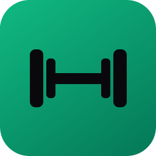
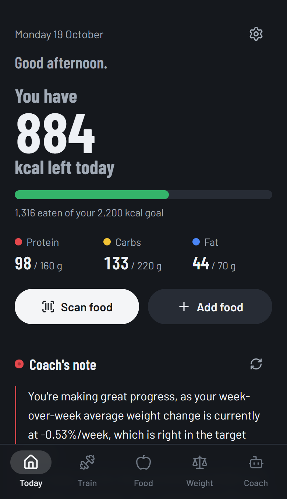
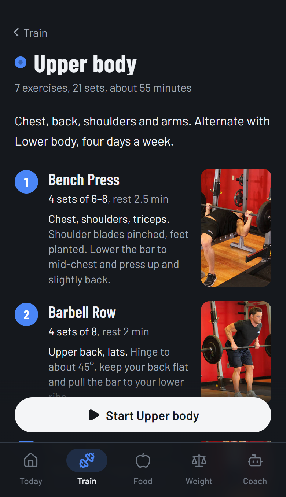
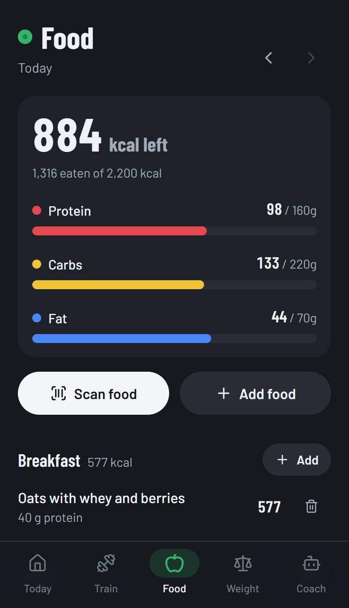
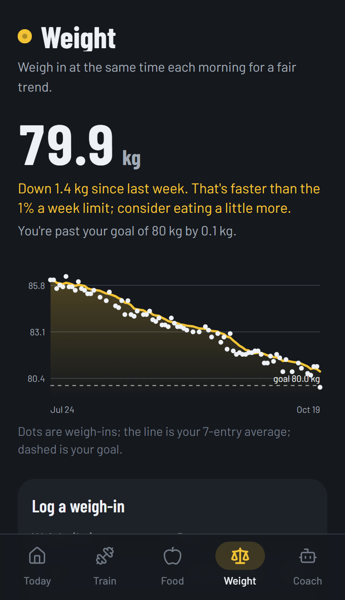
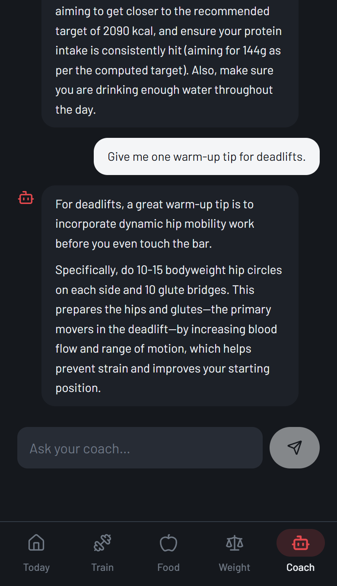
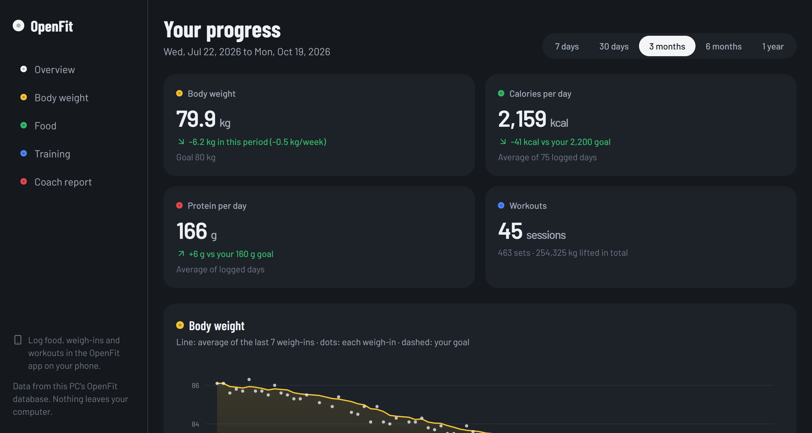

<div align="center">



# OpenFit

**Your own fitness app. Workouts, food, body weight and an AI coach, all running on your PC.**<br />
No subscription, no account, no cloud. Your data never leaves your home.

[](https://github.com/Vitzso/open-fit/releases)
[](LICENSE)


-e5484d)

[**Get started**](#-get-started) · [Features](#-what-you-get) · [Desktop app](#-desktop-app) · [Privacy](#-private-by-design) · [Full setup guide](SETUP.md) · [Changelog](CHANGELOG.md)

<br />







</div>

---

## ✨ What you get

| | |
|---|---|
| 🏋️ **Training** | Ready-made programs (full body, upper/lower, home) with photos and a form tip for every exercise, or build your own. Log sets in one tap: it remembers last time, suggests what to lift next, and runs a rest timer. |
| 🍎 **Food** | **Snap your plate or just say what you ate**: the local AI lists the foods with portions and macros, you check and add them in one tap. Or scan a barcode (Open Food Facts, millions of products), type it in, or re-log something recent. |
| ⚖️ **Body weight** | One weigh-in a day, a 7-day trend line, your goal, and an honest verdict on your pace. Weight, steps and active calories can arrive from **Apple Health** by themselves. |
| 📶 **Works with no signal** | Everything you log is saved on the phone first and syncs to your PC when it's reachable: gym basements and dead zones never lose a set. |
| 🧩 **Modules** | Optional extras you switch on in Settings. **Pro training** adds an 870-exercise library with photos, personal-record alerts, a plate and warm-up calculator, warm-up and drop sets, and your own programs. |
| 📥 **Bring your history** | Import from **MyFitnessPal**, **Strong** and **Hevy**, or restore an OpenFit backup. Duplicates are skipped, so importing twice is safe. |
| 🤖 **AI coach** | A local model (Gemma by default) that reads your real numbers: a short note every morning, weekly reviews, and answers to any training or nutrition question. Safety checks built in. |
| 🖥️ **Desktop dashboard** | A Windows and Mac app with big charts of your progress and a written progress report from the coach. |
| 🔒 **Yours** | Everything in one SQLite file on your PC. Passcode lock, HTTPS, works away from home over your choice of private network (Tailscale, WireGuard, ZeroTier, NetBird or your own VPN), one-click backup. |

## 🚀 Get started

You need a **Windows PC** (or a Mac, see below) that stays on while you use the app, and an **iPhone** on the same Wi-Fi.

1. **Download** OpenFit: the green **Code → Download ZIP** button above, or the latest [release](https://github.com/Vitzso/open-fit/releases). Unzip it anywhere.
2. **Double-click `Setup.cmd`.** It installs what's missing (Node.js, Ollama and the coach model, HTTPS certificates), asks you to choose a passcode, and adds an **OpenFit** shortcut to your Desktop. It skips anything already done, so it's also the repair button.
3. **Double-click OpenFit.** It starts everything and shows the address to open on your iPhone. In Safari, tap **Share → Add to Home Screen** and it works like a normal app.

Something not right? Double-click **`Validate.cmd`**: it checks every part of the install and fixes what's out of step. The full walkthrough, including Mac/Linux and using it away from home, is in **[SETUP.md](SETUP.md)**.

## 🖥️ Desktop app



The phone is for logging; the desktop app is for looking back. Charts for body weight, calories by macro, protein,
weekly training volume and every main lift, from the last 7 days to the last year, plus a progress report written by
your coach from the same numbers. It reads the same database as the phone, so there's nothing to sync.

**Windows:** install `OpenFit-Setup-x.y.z.exe` from the [latest release](https://github.com/Vitzso/open-fit/releases) and pick your OpenFit folder once.
**From source (Windows or Mac):** `npm run desktop:install` once, then `npm run desktop`. Details in [SETUP.md](SETUP.md#desktop-app-windows-and-mac-your-progress-on-a-big-screen).

## 🔒 Private by design

- **Nothing leaves your network.** The app, the database and the AI model all run on your PC. The only outside call is the barcode lookup (Open Food Facts), which sends the barcode and nothing else.
- **The phone never talks to the AI directly.** OpenFit relays coach requests, so Ollama can stay private to your PC.
- **Locked by a passcode** with brute-force protection, HTTPS with your own certificate authority, and protection against DNS-rebinding and cross-site requests.
- **Your data is a file you own:** `prisma/openfit.db`, plus a full JSON export in Settings.

## ⚙️ Configuration

Most settings live in the app (**Settings**, the gear icon on Today). The rest are in `.env`, which Setup creates from
[`.env.example`](.env.example). A value set in the app wins over `.env`.

| What | Where | Default | Notes |
|---|---|---|---|
| AI model | Settings → AI coach connection, or `OLLAMA_MODEL` | `gemma4:latest` | Any chat model from [ollama.com/library](https://ollama.com/library). Settings → Setup can download one. |
| Thinking level | Settings → AI coach connection, or `OLLAMA_REASONING_EFFORT` | `none` | `low` is smarter for a few seconds' pause on a fast GPU (thinking models only). |
| Ollama address | Settings → AI coach connection, or `OLLAMA_BASE_URL` | `http://127.0.0.1:11434` | Change only if Ollama runs on another machine. |
| Passcode | `APP_PASSCODE` (Setup asks for it) | none | Strongly recommended. Changing it signs every device out. |
| Extra hostnames | `ALLOWED_HOSTS` | none | Only for names the PC can't see itself. Its own IPs, `localhost`, `*.local`, Tailscale and NetBird names always work. |
| Goals, units, week start, body profile, coach instructions | Settings | 2,000 kcal, kg, Sunday | The calorie target card can fill your goals in for you. |
| Remote access | Settings → Remote access, or `REMOTE_ACCESS` | Tailscale | `tailscale`, `wireguard`, `zerotier`, `netbird`, `custom` (your own VPN; set `REMOTE_ADDRESS`) or `none`. See [Away from home](SETUP.md#away-from-home-tailscale-wireguard-zerotier-netbird-or-your-own). |
| Port | `PORT` environment variable | 3443 (HTTPS), 3000 (HTTP) | |

## 🧰 For developers

<details>
<summary><b>Scripts</b></summary>

| Script | What it does |
|---|---|
| `npm run dev` | Dev server on `0.0.0.0:3000` (HTTP) |
| `npm run dev:https` | Dev server over HTTPS using `certs/` |
| `npm run build` then `npm run start:https` | Production over HTTPS on port 3443 (what the launcher runs) |
| `npm run validate` | Check the install and repair inconsistencies (`-- -CheckOnly` to only report) |
| `npm run desktop:install` / `npm run desktop` | Install and run the desktop app from source |
| `npm run make:certs` / `make:shortcut` / `make:icon` | HTTPS certificates, Desktop shortcut, app icons |
| `npm run db:migrate` / `db:deploy` / `db:seed` / `db:studio` | Prisma helpers |
| `npm run typecheck` | `tsc --noEmit` |

</details>

<details>
<summary><b>Stack</b></summary>

Next.js 15 (App Router) · React 19 · Tailwind CSS 4 · Prisma 6 + SQLite · `@ducanh2912/next-pwa` · `@zxing/browser` ·
zod · lucide-react · Electron (desktop app) · Ollama (local AI). Charts are dependency-free SVG.

</details>

<details>
<summary><b>Folder layout</b></summary>

Layered and modular: **UI components** render, **hooks** hold client state, **services** make browser-side API calls,
**actions** validate and write, **lib** holds business logic and data access. One responsibility per file.

```
openfit/
├─ Setup.cmd · OpenFit.cmd · Validate.cmd   # one-click setup, start, and check-and-repair (Windows)
├─ launcher/                       # PowerShell behind those: setup steps, launcher, certificates, validator
├─ desktop/                        # Electron app: starts OpenFit's server on localhost, shows /desktop
├─ prisma/                         # schema.prisma, migrations, seed.mjs
├─ server.mjs                      # production HTTPS server (iOS camera needs HTTPS)
└─ src/
   ├─ app/                         # routes: Today, workouts, nutrition, weight, coach, settings, desktop, api/
   ├─ actions/                     # server actions, one file per domain (all writes)
   ├─ services/                    # browser → API calls; components never call fetch()
   ├─ components/                  # workout/, scanner/, food/, coach/, today/, settings/, desktop/ (+ charts)
   └─ lib/                         # ollama/ connector, coach/ prompt + data sections + self-tests,
                                   # dashboard, energy, progression, openfoodfacts, dates, units, …
```

</details>

<details>
<summary><b>Design notes</b></summary>

- **The phone never talks to Ollama directly.** `/api/coach` proxies the request, so there are no CORS or mixed-content problems.
- **Coach errors are reported before the stream starts**, as a JSON error with a fix-it hint instead of a half-open stream.
- **Weights are stored in kg** and converted for display, so switching between kg and lb is lossless.
- **Days are stored as local `YYYY-MM-DD` strings**, which avoids timezone bugs in "today" queries.
- **Coach averages exclude today**, because a half-logged day would make it look like you're under-eating.

</details>

## 📜 License and credits

MIT, see [LICENSE](LICENSE). Exercise photos: [free-exercise-db](https://github.com/yuhonas/free-exercise-db) by yuhonas,
public domain (Unlicense); stored in `public/exercises/`. Food data: [Open Food Facts](https://world.openfoodfacts.org) (ODbL).
Screenshots show made-up demo data.
